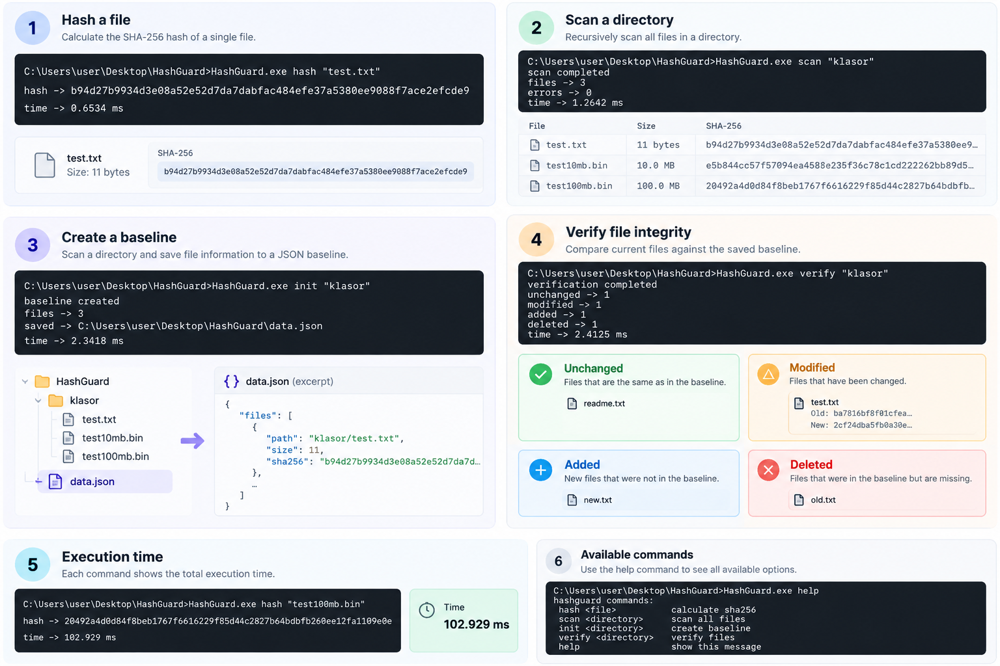

# HashGuard

A lightweight file integrity checker written in C++20 for Windows.

HashGuard uses SHA-256 hashing to detect changes in files and directories. It supports recursive directory scanning, JSON baselines, and file integrity verification through a simple command-line interface.

## Features

- SHA-256 hashing using Windows BCrypt
- Recursive directory scanning
- JSON baseline creation
- Detection of modified, added, and deleted files
- File integrity verification
- Command-line interface
- Execution time measurement

## Requirements

- Windows 10 or 11
- Visual Studio 2026 with C++ desktop development tools
- C++20

## Building

1. Clone or download the repository.
2. Open `HashGuard.slnx` in Visual Studio 2026.
3. Select `Release` and `x64`.
4. Build the solution.
5. Find `HashGuard.exe` in the build output directory.

## Usage

Open CMD in the directory containing `HashGuard.exe`.

### Hash a file

Calculate the SHA-256 hash of a single file.

```cmd
HashGuard.exe hash "C:\files\test.txt"
```

### Scan a directory

Recursively scan a directory and display file hashes and sizes.

```cmd
HashGuard.exe scan "C:\files"
```

### Create a baseline

Create a JSON baseline containing file paths, sizes, and SHA-256 hashes.

```cmd
HashGuard.exe init "C:\files"
```

The baseline is saved as `data.json` in the parent directory of the scanned folder.

### Verify file integrity

Compare the current directory contents against the saved baseline.

```cmd
HashGuard.exe verify "C:\files"
```

Possible results:

- `unchanged` — File content has not changed.
- `modified` — File content has changed.
- `added` — A new file was detected.
- `deleted` — A previously recorded file is missing.

### Help

Display available commands.

```cmd
HashGuard.exe help
```

## Example Output

```text
modified -> test.txt
added -> new.txt

verification completed
unchanged -> 0
modified -> 1
added -> 1
deleted -> 0

time -> 2.41 ms
```

## Performance

Initial SHA-256 performance measurements using the Release x64 build:

| File size | Execution time |
|-----------|----------------|
| 10 MiB | 10.83 ms |
| 100 MiB | 102.93 ms |

These are single-run measurements on one machine, including file I/O and command overhead. Results may vary depending on hardware and filesystem caching.

## Dependencies

- [nlohmann/json](https://github.com/nlohmann/json) — JSON parsing and serialization
- Windows BCrypt API — SHA-256 hashing

## Notes

- A baseline must be created before running verification.
- The baseline file is stored outside the scanned directory.
- Existing baselines are not overwritten by the `init` command.
- Baselines are not cryptographically authenticated and should be protected from unauthorized changes.
- File paths containing non-ASCII characters may not work correctly in the current CLI version.
- The application currently returns exit code `0` even when an error is reported.

## License

This project is licensed under the MIT License.

## Preview


